# PVC-Plus Resource Pack

A custom resource pack for Minecraft 1.21.5+ for players on Peaceful Vanilla Club that applies custom textures to PVC-specific items based on their display names and/or enchantments (NBT data).

## What's in the box?

Here's a visual reference of the custom items, categorized by their in-game toggle groups.

### Vote armor & tools
*Custom textures for vote weapons, tools, armor, and equipment.*

| Custom item | Original item | | New custom texture |
| :--- | :---: | :-: | :---: |
| **Justice** _(Netherite Sword)_ |  | ➔ | 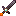 |
| **Lumberjack** _(Netherite Axe)_ |  | ➔ | 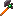 |
| **Sanctuary** _(Netherite Pickaxe)_ |  | ➔ | 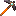 |
| **Tenacity** _(Netherite Shovel)_ |  | ➔ | 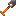 |
| **Pila del Pretoriano** _(Netherite Spear)_ |  | ➔ | 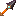 |
| **BareBones Wings** _(Elytra)_ |  | ➔ |  |

### Server currency
*Custom textures for economy certs, server tokens, and utility items.*

| Custom item | Original item | | New custom texture |
| :--- | :---: | :-: | :---: |
| **The Big Claim** _(Book)_ |  | ➔ | 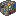 |
| **50 Votes Certificate** _(Diamond)_ |  | ➔ | 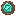 |
| **Playtime Certificate** _(Book)_ |  | ➔ |  |
| **T2 Playtime Cert.** _(Book)_ |  | ➔ |  |
| **Inactivity Certificate** _(Book)_ |  | ➔ |  |
| **Inactivity Ticket** _(Paper)_ |  | ➔ | 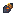 |
| **Bank O' Note** _(Paper)_ |  | ➔ |  |
| **Caddozzo** _(Amethyst Shard)_ |  | ➔ |  |
| **Nepero** _(Charcoal)_ |  | ➔ |  |
| **Quarry Extractor Fuel** _(Charcoal)_ |  | ➔ | 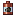 |
| **Lux** _(Light)_ |  | ➔ |  |
| **Vanguard Key** _(Nether Star)_ |  | ➔ |  |
| **Big Fat Diamond** _(Diamond Block)_ |  | ➔ | 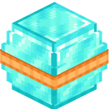 |
| **Super / Hyper / Uber Emerald** _(Emerald)_ |  | ➔ | 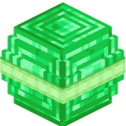 |

### Player currency
*Custom textures for player-minted currency, tokens, and relics.*

| Custom item | Original item | | New custom texture |
| :--- | :---: | :-: | :---: |
| **SKU Timepiece** _(Clock)_ |  | ➔ |  |
| **$Llama Coin** _(Heart of the Sea)_ |  | ➔ | 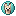 |
| **BB Coin** _(End Crystal)_ |  | ➔ |  |
| **SoTA** _(Echo Shard)_ |  | ➔ | 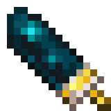 |

### Protection blocks
*Custom textures for Protection Stones with the number of blocks (plus 1 for the center) it will claim.*

| Custom item | Original item | | New custom texture |
| :--- | :---: | :-: | :---: |
| **Chunk Protection Block** _(Copper Ore)_ |  | ➔ | 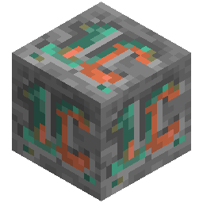 |
| **Mini Protection Block** _(Lapis Ore)_ |  | ➔ | 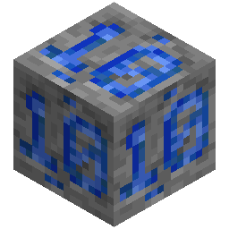 |
| **Nether Protection Block** _(Nether Gold Ore)_ |  | ➔ | 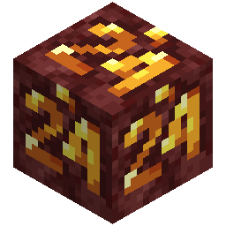 |
| **Standard Protection Block** _(Coal Ore)_ |  | ➔ | 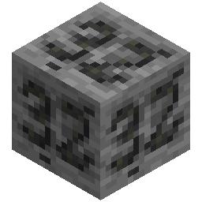 |
| **Large Protection Block** _(Redstone Ore)_ |  | ➔ | 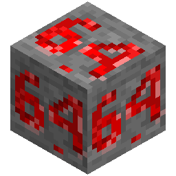 |
| **Mega Protection Block** _(Diamond Ore)_ |  | ➔ | 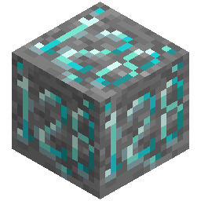 |
| **Super Protection Block** _(Deepslate Emerald Ore)_ |  | ➔ | 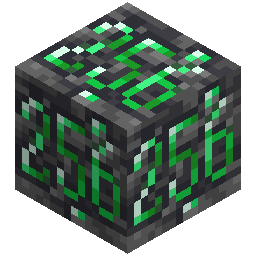 |

### Totems
*Custom player totems.*

| Custom item | Original item | | New custom texture |
| :--- | :---: | :-: | :---: |
| **Totem of DLJ** _(Totem of Undying)_ |  | ➔ |  |
| **Totem of Orwell** _(Totem of Undying)_ |  | ➔ | 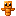 |

### Miscellaneous
*Specialty items, spawn eggs, and custom food.*

| Custom item | Original item | | New custom texture |
| :--- | :---: | :-: | :---: |
| **Squidward** _(Squid Spawn Egg)_ |  | ➔ |  |
| **Nerchius Poop** _(Brown Dye)_ |  | ➔ | 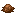 |
| **Very good cake** _(Cake)_ |  | ➔ | 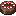 |
| **Very good bread** _(Bread)_ |  | ➔ |  |
| **Map art** _(Filled Map)_ |  | ➔ |  |

---

## Customization (Optional: Respackopts)

This pack includes built-in support for the **[Respackopts](https://modrinth.com/mod/respackopts)** mod, allowing you to pick and choose which of the categories you want on or off in-game.

### In-game configuration
If you have Respackopts installed:
1. Go to *Options* ➔ *Resource Packs*.
2. Click the settings button next to the PVC+ resource pack.
3. Toggle any of the 
categories on or off

---

## Installation

1. Download the compiled zip folder.
2. Place the zip file in your Minecraft `resourcepacks` folder.
3. Enable the resource pack in Minecraft settings.

## Technical Structure

The pack follows a strict separation between vanilla logic overrides and custom assets designed to support complex custom model mapping:

- **`assets/minecraft/items/*.json`**: Vanilla Item Model Logic that hijacks the original item and checks the name.
- **`assets/pvc-plus/models/item/*.json`**: Custom Item Models that are used by the Vanilla Item Model Logic, usually named for their in-game name.
- **`assets/pvc-plus/textures/item/`**: Project-specific visual texture assets, usually named for what they look like.
